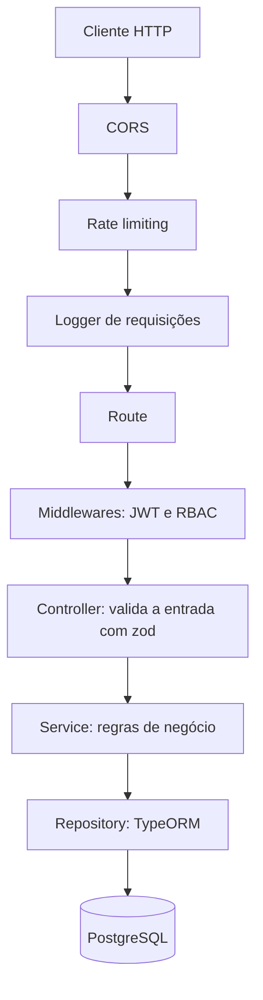

# MedClinic API

API REST para o gerenciamento de uma clínica médica de pequeno porte: especialidades, médicos, pacientes, consultas e relatórios, com autenticação JWT e controle de acesso por perfil (RBAC). Projeto avaliativo do curso de Desenvolvimento Back-End Node (SCTEC).

**Links:** [API em produção](https://medclinic-api-fui6.onrender.com) | [Documentação Swagger](https://medclinic-api-fui6.onrender.com/api-docs/) | [Quadro no Trello](https://trello.com/b/86WSAhUo/medclinic-api) | [Vídeo de apresentação](PREENCHER_LINK_DO_VIDEO)

## Problema que resolve

Clínicas pequenas costumam controlar médicos, pacientes e agenda em planilhas, o que gera consultas em duplicidade para o mesmo médico, dados inconsistentes e nenhuma visão gerencial. A MedClinic API centraliza tudo em um banco relacional e aplica as regras no servidor: impede agendamentos sobrepostos, garante CRM e CPF únicos e válidos, controla o ciclo da consulta e restringe cada ação ao perfil autorizado.

## Funcionalidades

- Autenticação com JWT (com expiração) e perfis Administrador e Atendente (RBAC)
- CRUD de especialidades, médicos e pacientes
- Agendamento, atendimento e cancelamento de consultas, com checagem de disponibilidade do médico
- Filtros e paginação (`page` e `limit`) nas listagens
- Relatórios gerenciais (somente Administrador)
- Documentação Swagger, logs com Winston, CORS e rate limiting
- Segurança: senhas com hash (bcrypt), segredos fora do código (`.env`) e validação de toda entrada com zod

## Tecnologias

Node.js · TypeScript · Express 5 · PostgreSQL · TypeORM (migrations) · JWT e bcrypt · zod · Swagger UI (OpenAPI 3) · Winston · cors · express-rate-limit · Jest (ts-jest) · Docker e Docker Compose

## Arquitetura

MVC em camadas: cada camada conversa apenas com a seguinte, e todo erro chega ao `errorMiddleware`, que responde em JSON padronizado.



Pastas em `src/`: `routes`, `middlewares`, `controllers`, `services`, `repositories`, `entities`, `dtos`, `validations`, `config`, `docs` (OpenAPI), `database` (migrations e seed) e `utils`.

## Como executar

**Pré-requisitos:** Node.js 20.19+, 22.13+ ou 24.11+ (faixas exigidas pelo TypeORM) e PostgreSQL em execução. Para a execução com Docker, veja a seção seguinte.

```bash
git clone https://github.com/Brrn91/medclinic-api.git
cd medclinic-api
npm ci
cp .env.example .env          # preencha DB_PASSWORD e JWT_SECRET
psql -U postgres -c "CREATE DATABASE medclinic;"
npm run migration:run         # cria as tabelas (migrations do TypeORM)
npm run seed:admin            # cria o administrador inicial
npm run dev                   # http://localhost:3000
```

Produção: `npm run build` e `npm start`. Para desfazer a última migration: `npm run migration:revert`.

> Avisos de `allow-scripts` no `npm ci` não bloqueiam. Se o hash de senha falhar, rode `npm approve-scripts bcrypt`.

## Executando com Docker

Sobe a API e um PostgreSQL 16 com um único comando. Requer Docker com Compose.

```bash
cp .env.example .env          # preencha DB_PASSWORD e JWT_SECRET
docker compose up --build -d
docker compose exec api node ./node_modules/typeorm/cli.js migration:run -d dist/database/data-source.js
docker compose exec api node dist/database/seeds/seed-admin.js
```

- A API fica em `http://localhost:3000` e o Swagger em `http://localhost:3000/api-docs/`.
- O compose define `DB_HOST=db` automaticamente; os demais valores vêm do `.env`.
- As migrations e o seed rodam **dentro do contêiner**, usando o código compilado (`dist/`), porque a imagem de produção não inclui as dependências de desenvolvimento (como o `tsx`).
- O banco não é exposto ao host e seus dados ficam no volume `postgres_data`.
- Logs: `docker compose logs -f api`. Para parar: `docker compose down` (use `-v` para apagar também o volume do banco).

### Variáveis de ambiente

Todas estão em `.env.example` (o `.env` real não é versionado). `RATE_LIMIT_*`, `LOG_LEVEL` e `SEED_*` são opcionais; a coluna de padrão mostra o valor usado pelo código quando a variável não é definida.

| Variável                                                        | Padrão do código                                                     | Descrição                                                     |
| --------------------------------------------------------------- | -------------------------------------------------------------------- | ------------------------------------------------------------- |
| `PORT`                                                          | (obrigatória; exemplo `3000`)                                        | Porta da API                                                  |
| `DB_HOST`, `DB_PORT`, `DB_NAME`, `DB_USER`, `DB_PASSWORD`       | (obrigatórias; exemplo `localhost`, `5432`, `medclinic`, `postgres`) | Conexão com o PostgreSQL                                      |
| `JWT_SECRET`, `JWT_EXPIRES_IN`                                  | (obrigatórias; exemplo `1h`)                                         | Assinatura e validade do token                                |
| `CORS_ORIGINS`                                                  | (obrigatória)                                                        | Origens permitidas, separadas por vírgula (`*` é recusado)    |
| `RATE_LIMIT_WINDOW_MS`, `RATE_LIMIT_MAX`, `AUTH_RATE_LIMIT_MAX` | `900000`, `100`, `10`                                                | Janela (ms), limite global e limite de login/cadastro, por IP |
| `LOG_LEVEL`                                                     | `info`                                                               | `error`, `warn`, `info`, `http` ou `debug`                    |
| `SEED_ADMIN_NAME`, `SEED_ADMIN_EMAIL`, `SEED_ADMIN_PASSWORD`    | (obrigatórias para rodar o seed)                                     | Administrador criado pelo seed (senha com 8+ caracteres)      |

O `.env.example` já traz limites mais altos (`1000` e `100`) para facilitar testes manuais. Para observar o `429 Too Many Requests` rapidamente, use `AUTH_RATE_LIMIT_MAX=5` no seu `.env`.

### Credenciais de teste

| Perfil               | E-mail                               | Senha        |
| -------------------- | ------------------------------------ | ------------ |
| Administrador (seed) | `admin@medclinic.com`                | `senha12345` |
| Atendente            | cadastre-se em `POST /auth/register` | a sua        |

São credenciais apenas de desenvolvimento: troque-as em qualquer ambiente real.

## Documentação da API (Swagger)

Com a API rodando: **<http://localhost:3000/api-docs>**. Em produção: [medclinic-api-fui6.onrender.com/api-docs](https://medclinic-api-fui6.onrender.com/api-docs/). Para testar as rotas protegidas, faça `POST /auth/login`, copie o `token`, clique em **Authorize** e cole o token.

## Deploy

A API está publicada no Render: <https://medclinic-api-fui6.onrender.com>. Se a instância estiver em repouso, a primeira requisição pode demorar cerca de um minuto até a aplicação acordar.

## Endpoints e perfis de acesso

Perfis: **ADMIN** (acesso completo) e **ATTENDANT** (operacional). Rotas protegidas exigem `Authorization: Bearer <token>`. Os detalhes de cada rota (parâmetros, corpos e respostas) estão no Swagger.

| Módulo                   | Rotas                                                                                                                               | Perfis               |
| ------------------------ | ----------------------------------------------------------------------------------------------------------------------------------- | -------------------- |
| Auth                     | `POST /auth/register` (cria Atendente), `POST /auth/login`                                                                          | Público              |
| Usuário                  | `GET /users/me`                                                                                                                     | Qualquer autenticado |
| Especialidades e médicos | `GET /` e `GET /:id`                                                                                                                | Admin e Atendente    |
|                          | `POST`, `PUT /:id`, `DELETE /:id`                                                                                                   | Admin                |
| Pacientes                | `GET /`, `GET /:id`, `POST`, `PUT /:id`                                                                                             | Admin e Atendente    |
|                          | `DELETE /:id`                                                                                                                       | Admin                |
| Consultas                | `GET /`, `GET /:id`, `POST`, `PATCH /:id/atendimento`, `PATCH /:id/cancelamento`                                                    | Admin e Atendente    |
| Relatórios               | `GET /relatorios/consultas-por-status`, `/consultas-por-medico`, `/medicos-por-especialidade`, `/pacientes-com-consultas-agendadas` | Admin                |
| Sistema                  | `GET /health`, `GET /api-docs` (públicas), `GET /admin/ping` (Admin)                                                                |                      |

Prefixos: `/especialidades`, `/medicos`, `/pacientes` e `/consultas`.

## Regras de negócio

- **Validação e unicidade:** nome da especialidade único; CRM único no formato `12345/SC`; CPF único e válido (dígitos verificadores); e-mail e data de nascimento validados.
- **Vínculos:** o médico exige uma especialidade existente. Não é possível remover especialidade com médicos, nem médico ou paciente com consultas (409).
- **Agendamento:** horário futuro; cada consulta ocupa 30 minutos do médico, e a sobreposição retorna 409 (verificação transacional, com lock por médico).
- **Status:** `agendada` vira `realizada` (exige observações) ou `cancelada`. Consultas finalizadas não podem ser alteradas (409), e cancelar libera o horário.
- **Listagens:** `page` (padrão 1) e `limit` (padrão 10, máximo 100), com `meta` (`total`, `page`, `limit`, `totalPages`).
- **Erros:** toda falha responde `{ "status": "error", "message": "..." }`, com os códigos 400, 401, 403, 404, 409, 429 e 500.

## Logs (Winston)

Gravados no console e em `logs/combined.log` (tudo, em JSON) e `logs/error.log` (só erros). A pasta `logs/` é criada automaticamente e não é versionada. O nível mínimo vem de `LOG_LEVEL` (com `http`, cada requisição aparece com método, rota, status e tempo). São registrados requisições, autenticação, acessos negados, erros, rate limit e operações de consulta. Senhas, tokens, CPF e observações clínicas nunca vão para o log. No Docker, os arquivos ficam dentro do contêiner; use `docker compose logs -f api` para acompanhar.

## Testes automatizados (Jest)

32 testes unitários em 3 suítes, com Jest e ts-jest e os repositórios simulados (mocks), sem acessar o banco de dados. Cobrem o serviço de autenticação e os serviços de consultas e de especialidades: regras de negócio, conflito de horário, transições de status e tradução de erros do banco.

```bash
npm test                 # executa os testes
npm run test:coverage    # relatório de cobertura
```

## Testes com Postman

Importe os arquivos de `docs/postman/` e execute a collection (mais de 200 asserções). Para rodá-la mais de uma vez em 15 minutos, use `RATE_LIMIT_MAX=1000` no `.env`.

## Gestão do projeto

- **Trello:** <https://trello.com/b/86WSAhUo/medclinic-api>
- **Git:** uma branch por tarefa (`feat/*`, `fix/*`, `docs/*`) a partir da `develop`, integrada por Pull Request com commit de merge (as branches são mantidas), com commits semânticos. A `main` recebe a `develop` nas entregas.
- **Principais branches:** `feat/setup-projeto`, `feat/rbac`, `feat/winston-logger`, `feat/cors-rate-limit`, `feat/seed-admin`, `feat/especialidades`, `feat/medicos`, `feat/pacientes`, `feat/consultas`, `feat/relatorios`, `feat/swagger-docs`, `feat/jest-tests`, `fix/audit-proxy-addr`, `fix/audit-body-parser`, `docs/readme-final` e `docs/readme-completo`.

## Vídeo de apresentação

[Assista ao vídeo do projeto](PREENCHER_LINK_DO_VIDEO)

## Melhorias futuras

- Executar as migrations automaticamente na subida do contêiner, sem comando manual
- Perfil Médico (o diagnóstico seria registrado só por quem atende) e trilha de auditoria
- Reagendamento de consultas e duração configurável por médico ou especialidade
- Fuso horário da clínica configurável e rotação dos arquivos de log
- Refresh token e revogação de sessões

## Autor

Lucas Bruno da Costa Mafra · [github.com/Brrn91](https://github.com/Brrn91)
